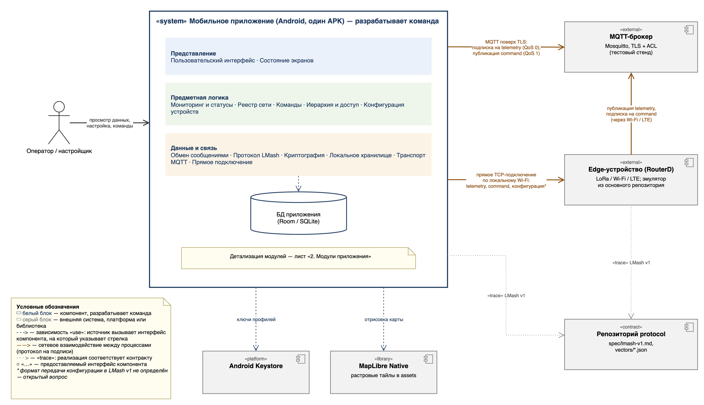
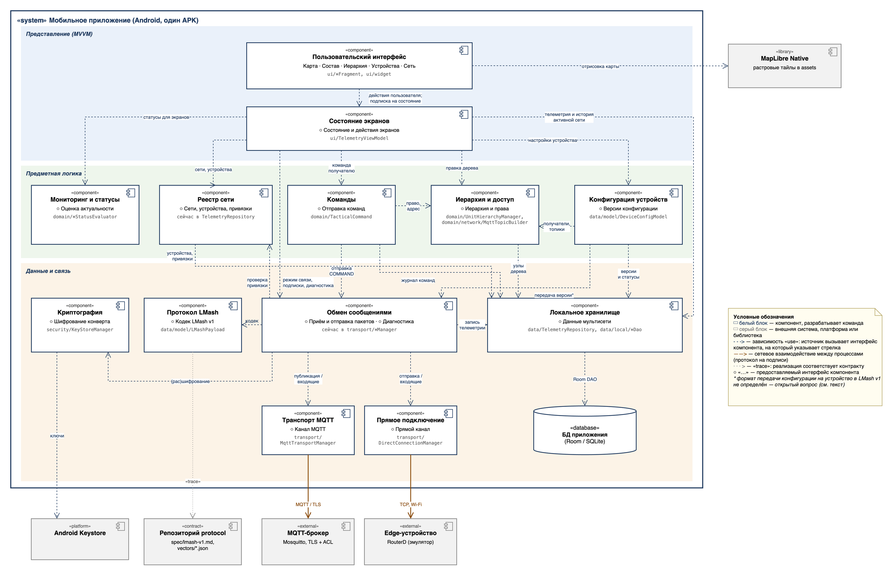

# Архитектура проекта

Документ описывает устройство мобильного приложения распределённой системы мониторинга: из каких модулей оно состоит, как они взаимодействуют между собой и с внешними системами, какие технологии выбраны и почему.

Основание — материалы общей системы: [пользовательские истории и MVP](https://github.com/Myakita/mobile-embedded-system/blob/main/docs/User%20stories%20%D0%B8%20MVP.md), [требования к MVP](https://github.com/Myakita/mobile-embedded-system/blob/main/docs/%D0%A2%D1%80%D0%B5%D0%B1%D0%BE%D0%B2%D0%B0%D0%BD%D0%B8%D1%8F%20%D0%BA%20MVP.md) и [спецификация протокола LMash v1](https://github.com/Myakita/mobile-embedded-system-protocol/blob/main/spec/lmash-v1.md). Из них взята только мобильная часть: edge-устройства (`RouterD`), MQTT-брокер и сборка Linux-образа для этой команды — внешние компоненты.

Описана **целевая и фактическая архитектура мобильного приложения**, включая модули тактического анализа и реестр расхождений текущего кода со схемой.

---

## 1. Общий подход и обоснование

### 1.1. Тип архитектуры

Приложение — **одно Android-приложение (один APK), внутри которого модули разделены на три слоя**: представление, предметная логика, данные и связь. Это модульный монолит со слоёной структурой. Слой представления построен по схеме MVVM: экраны наблюдают за состоянием, которое хранит ViewModel, и передают ей действия пользователя.

Зависимости направлены сверху вниз:
- Экран знает о состоянии экранов (`ViewModel`);
- Состояние — о модулях предметной логики (`Domain`);
- Предметная логика — о хранилище и обмене сообщениями (`Data & Transport`);
- Нижние слои ничего не знают об экранах и сообщают о новых данных через наблюдаемые запросы `LiveData`.

С внешним миром приложение работает как клиент по двум каналам:
- **Через MQTT-брокер** по схеме «публикация/подписка»: телеметрия приходит по подписке, команды публикуются в топик получателя;
- **Напрямую с edge-устройством** по TCP в локальной сети Wi-Fi: этот канал нужен, когда брокер недоступен.

Прикладного сервера (backend) нет. Брокер только пересылает сообщения, а правила доступа, история телеметрии и конфигурация сети хранятся и выполняются на телефоне.

### 1.2. Где находятся взаимодействие, правила и хранение

| Что | Где в системе |
|---|---|
| Пользовательское взаимодействие | Слой «Представление»: модуль «Пользовательский интерфейс» (пять вкладок: Карта, Состав, Иерархия, Устройства, Сеть) и модуль «Состояние экранов». |
| Основные правила и тактика | Слой «Предметная логика»: актуальность позиции и состояние устройства, пороги тревог по телеметрии, геометрический центр и кольца дальности, учет сетей и привязок, иерархия и права на команды, формирование команд, версии конфигурации. |
| Правила приёма пакетов | Модуль «Обмен сообщениями»: снятие конверта, расшифрование, проверка версии и TTL, дедупликация, проверка привязки устройства. |
| Хранение | Модуль «Локальное хранилище» и СУБД Room (SQLite) в песочнице приложения. Секретные ключи — в аппаратном хранилище Android Keystore. |
| Работает в одном приложении | Все внутренние модули: один процесс, единый выпуск APK. |
| Внешние системы | MQTT-брокер (Mosquitto с TLS и ACL), edge-устройства (`RouterD`), подмодуль `protocol` со спецификацией, Android Keystore, библиотека MapLibre Native. |

### 1.3. Почему это устройство подходит проекту

- **Работа без сервера и без Интернета — требование MVP.** Прикладной backend исключён. Оператор должен видеть данные при недоступном брокере (US-11) и не терять настройки после перезапуска (US-14). Правила, история и конфигурация работают на самом телефоне.
- **Один выпуск достаточен.** Все модули поставляются вместе в одном APK. Разбиение на несколько процессов добавило бы IPC без пользы для сценариев.
- **Слои и MVVM — стандарт Android Jetpack.** ViewModel сохраняет состояние при повороте экрана, а подписки LiveData привязаны к жизненному циклу.
- **Правила проверяются без эмулятора.** Предметная логика, протокол и криптография тестируются на JVM командой `./gradlew test`. В CI тесты запускаются быстро без поднятия Android-эмулятора.
- **Границы модулей совпадают с распределением работы.** Аналитик и владелец продукта согласуют экраны; разработчик реализует транспорт и логику; тимлид контролирует интерфейсы на ревью; протокол меняется синхронно с embedded-командой через сабмодуль `protocol`.

### 1.4. Ограничения и компромиссы

- **Нет синхронизации между приложениями.** Конфигурацию мультисети ведёт назначенный клиент. История телеметрии хранится локально на принявшем устройстве.
- **Проверка прав в приложении — не граница безопасности.** Приложение блокирует отправку недопустимых команд в UI, но истинную защиту обеспечивают ACL брокера и верификация на самом edge-устройстве.
- **Всё работает в одном процессе.** Модуль обмена сообщениями обязан безопасно отбрасывать повреждённые и неизвестные пакеты, не допуская аварийного падения процесса.
- **Подложка карты — фиксированный офлайн-регион.** Тайлы поставляются в `assets/` APK; динамическая загрузка регионов на лету исключена из MVP.
- **Прямое подключение ограничено локальным Wi-Fi.** Прямой линк по LTE/IP (US-20) вынесен за рамки первой версии.
- **Фоновые пулы потоков вместо корутин.** Ядро стандартизировано на Java 17; асинхронные задачи выполняются через `ExecutorService` с передачей результата в главный поток через LiveData.

### 1.5. Состав первой версии и развитие

| Группа | Функции | Модули |
|---|---|---|
| MVP, обязательное (M) | Мультисети и переключение (US-01); пользователи, устройства и привязка без конфликтов (US-02); иерархия и пересчёт правил (US-03); настройка устройства со статусом (US-04); списки, карточки и карта со статусами CURRENT / STALE / UNKNOWN (US-06, US-07); команда CHECK_IN со статусом (US-08); MQTT через Wi-Fi/LTE (US-09); дедупликация (US-10); прямое Wi-Fi подключение (US-11); профиль AES-128-GCM (US-12); изоляция сетей (US-13); сохранение после перезапуска (US-14) | Все модули схемы |
| MVP, желательное (S) | История телеметрии за период (US-15), офлайн-регион карты (US-16), подробная бортовая диагностика (US-17) | Локальное хранилище, Пользовательский интерфейс, Обмен сообщениями |
| После MVP | Поиск и фильтры (US-18), системные уведомления (US-19), прямое LTE/IP подключение (US-20) | Существующие модули |
| Реализовано в коде сверх базового MVP | Директивы HOLD и RETURN (US-22); алгоритмы AES-256-GCM и ChaCha20-Poly1305 (US-21); экспорт трека в GPX и KML; кольца дальности, центр группы и целеуказание; тревоги личного состава по порогам пульса и температуры | Команды, Криптография, Мониторинг и статусы, UI |

Имитатор телеметрии (`data/MockTelemetryGenerator`) — тестовый режим для отладки UI без брокера.

---

## 2. Схема архитектуры

Нотация — UML, диаграмма компонентов. Исходник: [`architecture/architecture.drawio`](architecture/architecture.drawio), открывается в [draw.io](https://www.drawio.com/).

**Лист 1 — контекст и границы.** Внешние стыки приложения с брокером и маршрутизатором RouterD.

**Лист 2 — модули приложения.** Слои, предоставляемые интерфейсы и зависимости.

Обозначения:
- **Белый блок** со значком компонента — внутренний разрабатываемый модуль; **серый блок** — внешняя система, платформа или библиотека;
- Строка `○ …` внутри блока — предоставляемый модулем интерфейс;
- Пунктирная стрелка `use` — вызов зависимого интерфейса;
- Сплошная коричневая стрелка — сетевое межпроцессное взаимодействие с указанием протокола;
- Точечная серая стрелка `trace` — трассировка соответствия внешнему контракту спецификации;
- Моноширинный шрифт — путь размещения в коде (`app/src/main/java/com/example/mobile_embedded_system/…`).

---

## 3. Модули и их функции

### 3.1. Пользовательский интерфейс (Presentation)
- **Назначение:** экраны приложения и приём действий оператора.
- **Функции:** пять вкладок нижней навигации: Карта (маркеры участников с поворотом по азимуту, давность позиции, треки), Состав (список и карточка участника), Иерархия (дерево подразделений), Устройства (настройка и статус параметров), Сеть (подключение и диагностика пакетов). Защита от случайной отправки команд удержанием кнопки (`HoldToConfirmButton`).
- **Границы:** не содержит предметной логики; отображает данные из ViewModel и делегирует ей события ввода.
- **Данные:** только отображаемые структуры UI.
- **Взаимодействие:** подписка на LiveData из «Состояния экранов», вызовы методов действий; обращение к MapLibre SDK для карты.
- **Код:** `ui/*Fragment`, `ui/*Adapter`, `ui/widget/HoldToConfirmButton`, `MainActivity`, `res/layout`.

### 3.2. Состояние экранов (ViewModel)
- **Назначение:** единый координационный центр экранов.
- **Функции:** хранение активной сети, выбранного бойца, сетевого режима (MQTT, TCP Direct, Mock); трансляция действий пользователя в предметные сервисы; трансформация сущностей БД в UI-модели.
- **Границы:** не выполняет прямых вызовов сетевых сокетов и SQL-запросов.
- **Данные:** ID сети, ID выбранного бойца, режим работы, состояние карты.
- **Взаимодействие:** предоставляет экранам `TelemetryViewModel`; вызывает доменные сервисы, хранилище и транспорты.
- **Код:** `ui/TelemetryViewModel`.

### 3.3. Мониторинг, статусы и тактический расчет (Domain)
- **Назначение:** вычисление валидности данных, тактической геометрии и тревожных событий.
- **Функции:**
  - Определение статуса позиции: `CURRENT` (<30 с), `STALE` (>=30 с), `UNKNOWN` (координаты 0,0 или отсутствие связи);
  - Определение статуса узла: `ONLINE` / `OFFLINE`;
  - `SquadAlertManager`: контроль критических порогов температуры тела и частоты сердечных сокращений бойцов с генерацией предупреждений;
  - `TacticalWaypointManager`: расчёт геометрического центра подразделения, колец дистанции (Range Rings) и целеуказания; экспорт треков в GPX/KML.
- **Границы:** детерминированные чистые вычисления в памяти без обращений к I/O.
- **Код:** `domain/PositionStatusEvaluator`, `domain/DeviceStatusEvaluator`, `domain/TacticalStatusEvaluator`, `domain/SquadAlertManager`, `domain/TacticalWaypointManager`.

### 3.4. Реестр сети
- **Назначение:** топологический учет сетей, устройств и привязок к бойцам.
- **Функции:** регистрация сетей с индивидуальным MQTT-префиксом; связывание серийного номера трекера с пользователем; проверка коллизий привязки; верификация легитимности пары `deviceSerial — userId` во входящих пакетах.
- **Границы:** отделен от графа организационной структуры.
- **Данные:** записи мультисетей, профили устройств, связки с пользователями.
- **Код:** методы `registerDevice`, `reassignDevice`, `isDeviceBindingValid` в `data/TelemetryRepository`; сущности `NetworkEntity`, `DeviceEntity`.

### 3.5. Иерархия и доступ
- **Назначение:** организационная структура подразделения и разграничение полномочий.
- **Функции:** древовидная структура узлов; проверка субординации (командир -> подчинённый); расчёт разрешённых адресатов; построение MQTT-топиков по шаблону `<network_root>/<hierarchy_path>/<message_type>/to/<dst>/from/<src>` и масок подписки.
- **Границы:** передает наружу готовые топики и идентификаторы, не выполняя сетевой отправки.
- **Код:** `domain/UnitHierarchyManager`, `domain/HierarchyNode`, `domain/network/MqttTopicBuilder`.

### 3.6. Команды
- **Назначение:** формирование и контроль исполнения директив.
- **Функции:** сборка команд `CHECK_IN`, `HOLD`, `RETURN`; авторизация через иерархию; ведение журнала со статусами (`CREATED -> DISPATCHED -> CONFIRMED / FAILED`).
- **Границы:** делегирует сериализацию и шифрование модулю обмена сообщениями.
- **Код:** `domain/TacticalCommand`, `data/local/CommandEntity`, методы диспетчеризации в `TelemetryViewModel`.

### 3.7. Конфигурация устройств
- **Назначение:** подготовка и версионирование параметров периферии.
- **Функции:** сборка параметров радиоинтерфейсов (LoRa, Wi-Fi, LTE, периоды опроса датчиков); инкремент версий конфигурации; контроль статусов применения (`PENDING`, `APPLIED`, `ERROR`).
- **Границы:** физическая доставка конфигурации делегируется транспорту прямого подключения.
- **Код:** `data/model/DeviceConfigModel`, `data/model/ConfigSyncState`, `data/local/DeviceConfigEntity`.

### 3.8. Обмен сообщениями
- **Назначение:** единый унифицированный конвейер обработки пакетов.
- **Функции:** дешифрация конвертов, разбор бинарного формата LMash v1, отсечение неизвестных версий и истекшего TTL, фильтрация дубликатов по ключу `deviceSerial:sequence`, проверка привязки оборудования, учёт счетчиков диагностики.
- **Границы:** не управляет сокетами напрямую (вызывает транспорты).
- **Код:** `processIncomingMessage` в `MqttTransportManager`, `processDirectIncomingPacket` в `DirectConnectionManager`, `data/model/PacketDiagnosticsModel`.

### 3.9. Протокол LMash v1
- **Назначение:** бинарный кодек прикладного формата телеметрии.
- **Функции:** сериализация и десериализация 54-байтных структур (little-endian), конвертация масштабированных целых чисел (температура `x100`, координаты `E7`, курс `cdeg`).
- **Границы:** чистый парсер; контракт синхронизирован с сабмодулем `protocol`.
- **Код:** `data/model/LMashPayload`.

### 3.10. Криптография
- **Назначение:** шифрование и контроль целостности пакетов.
- **Функции:** аппаратная изоляция симметричных ключей в Android Keystore; шифрование и дешифрация профилей **AES-128-GCM** (MVP), **AES-256-GCM** и **ChaCha20-Poly1305**; генерация ошибок аутентификации (`AUTHENTICATION_FAILED`).
- **Границы:** возвращает расшифрованные массивы байт либо типизированные ошибки.
- **Код:** `security/KeyStoreManager`, `security/CryptoProfile`, `security/CryptoErrorCode`.

### 3.11. Локальное хранилище
- **Назначение:** персистентность данных телеметрии и топологии.
- **Функции:** сохранение через Room ORM; дедупликация на уровне СУБД (UNIQUE constraint по `device_serial` и `sequence`); изолированные выборки по `network_id`; отдача наблюдаемых запросов `LiveData`.
- **Границы:** абстрагирует схему таблиц SQLite от верхних слоев.
- **Код:** `data/TelemetryRepository`, `data/local/AppDatabase`, `data/local/*Dao`, `data/local/*Entity`.

### 3.12. Транспорт MQTT
- **Назначение:** шлюз связи с внешним брокером.
- **Функции:** поддержание сессии MQTT 3.1.1 через Eclipse Paho; TLS-шифрование; автопереподключение при переключении Wi-Fi/LTE с переоформлением подписок; публикация с подтверждением QoS 1.
- **Код:** `transport/MqttTransportManager`.

### 3.13. Прямое подключение (Direct TCP)
- **Назначение:** аварийная локальная связь с маршрутизатором RouterD по Wi-Fi.
- **Функции:** клиентский TCP-сокет (`192.168.4.1:9000`); потоковое чтение, буферизация кадров; передача команд и конфигураций при отсутствии сетевой инфраструктуры.
- **Код:** `transport/DirectConnectionManager`.

### 3.14. Обоснование декомпозиции
- Независимость доменных правил от UI: логика порогов тревог и актуальности фикса тестируется на JVM за доли секунды.
- Единый конвейер приёма: правила проверки дублей идентичны для пакетов из брокера и из TCP-сокета.
- Разделение оборудования и подразделений: перемещение трекера между бойцами не требует перестроения графа роты.

---

## 4. Связи и интерфейсы

### 4.1. Матрица взаимодействий модулей

| Откуда -> куда | Назначение связи | Способ | Общая логика |
|---|---|---|---|
| Пользовательский интерфейс -> Состояние экранов | Отображение данных и передача действий оператора | Внутренний вызов; подписка на LiveData | Экран подписывается на данные выбранного бойца и сети. Действия передаются вызовами методов ViewModel. |
| Состояние экранов -> Мониторинг и статусы | Расчёт актуальности, тактики и тревог | Внутренний вызов | Передаётся запись телеметрии; возвращаются статусы CURRENT/STALE/UNKNOWN, флаги тревог ЧСС/температуры и геометрия группы. |
| Состояние экранов -> Реестр сети | Управление сетями и устройствами | Внутренний вызов | Регистрация сетей, привязка трекеров, проверка отсутствия коллизий адресации. |
| Состояние экранов -> Иерархия и доступ | Навигация и изменение дерева роты | Внутренний вызов | Чтение и модификация графа подразделения, проверка циклов, расчёт прав на отправку приказов. |
| Состояние экранов -> Команды | Отправка тактической директивы | Внутренний вызов | Передача типа команды и адресата после удержания кнопки подтверждения оператором. |
| Состояние экранов -> Конфигурация устройств | Параметризация трекера | Внутренний вызов; подписка LiveData | Формирование новой версии параметров; наблюдение за переходом статуса в APPLIED. |
| Состояние экранов -> Обмен сообщениями | Управление связью и диагностика | Внутренний вызов | Выбор режима (MQTT / TCP / Demo), передача топиков подписки, считывание счётчиков пакетов. |
| Состояние экранов -> Локальное хранилище | Запрос данных для экранов | Наблюдаемый запрос LiveData | Выборка телеметрии и истории. Room инициирует автоматическое обновление интерфейса при записи нового кадра. |
| Команды -> Иерархия и доступ | Авторизация приказа | Внутренний вызов | Проверка подчиненности получателя отправителю. При отсутствии прав команда блокируется. |
| Команды -> Обмен сообщениями | Доставка директивы | Внутренний вызов | Передача команды в транспортный конвейер для шифрования и публикации. |
| Команды -> Локальное хранилище | Журналирование команд | Внутренний вызов (фоновый поток) | Фиксация директивы и статусов CREATED -> DISPATCHED -> CONFIRMED в SQLite. |
| Конфигурация устройств -> Иерархия и доступ | Расчёт сетевых параметров | Внутренний вызов | Определение разрешённых топиков и ID командиров для профиля конфигурации. |
| Конфигурация устройств -> Обмен сообщениями | Доставка параметров на трекер | Внутренний вызов | Отправка конфигурационного кадра через прямой TCP-канал. |
| Конфигурация устройств -> Локальное хранилище | Персистентность версий | Внутренний вызов | Сохранение версий конфигурации и истории их подтверждения устройством. |
| Реестр сети -> Локальное хранилище | Хранение привязок | Внутренний вызов | Запись связок серийный номер — боец с гарантией уникальности средствами Room. |
| Иерархия и доступ -> Локальное хранилище | Хранение дерева роты | Внутренний вызов (фоновый поток) | Чтение структуры подразделения при старте и персистентность изменений графа. |
| Обмен сообщениями -> Реестр сети | Верификация отправителя кадра | Внутренний вызов | Проверка пары deviceSerial и userId входящего кадра. Невалидные кадры отбрасываются. |
| Обмен сообщениями -> Протокол LMash | Кодирование и декодирование | Внутренний вызов | Преобразование сырых 54 байт в объект LMashPayload и обратная сборка команд. |
| Обмен сообщениями -> Криптография | Аутентификация и дешифрация | Внутренний вызов | Проверка AEAD-тега целостности и дешифрация полезной нагрузки ключом из Keystore. |
| Обмен сообщениями -> Локальное хранилище | Запись телеметрии | Внутренний вызов (фоновый поток) | Сохранение валидного кадра. Повторный кадр с парой (device_serial, sequence) отсекается СУБД. |
| Обмен сообщениями -> Транспорт MQTT | Публикация и приём | Внутренний вызов; Callback | Публикация исходящих директив в топик; приём входящих пакетов брокера через Callback. |
| Обмен сообщениями -> Прямое подключение | Передача фреймов по TCP | Внутренний вызов; Callback | Отправка кадров в сокет; приём входящих кадров из локального Wi-Fi линка. |
| Транспорт MQTT -> MQTT-брокер | Сетевая доставка | MQTT 3.1.1 по TLS | Публикация с гарантией QoS 1; восстановление подписок при смене интерфейсов Wi-Fi/LTE. |
| Прямое подключение -> Edge-устройство | Автономное сопряжение | TCP-сокет по Wi-Fi | Прямой обмен кадрами с портом демона RouterD (192.168.4.1:9000). |
| Криптография -> Android Keystore | Криптографические примитивы | API платформы (JCA) | Выполнение операций шифрования/дешифрации без извлечения закрытых ключей в память. |
| Локальное хранилище -> БД SQLite | Физическое сохранение | Room DAO | Транзакционное исполнение SQL-запросов в изолированной БД. |
| Пользовательский интерфейс -> MapLibre Native | Отрисовка карты | MapLibre SDK API | Рендеринг локальных векторных/растровых тайлов, маркеров и треков без Интернета. |

### 4.2. Сценарий: приём телеметрии от трекера до интерфейса
1. Кадр телеметрии принимается из сети `MqttTransportManager` либо сокетом `DirectConnectionManager`.
2. Транспорт передает байты в «Обмен сообщениями».
3. `KeyStoreManager` проверяет целостность AEAD-тега и расшифровывает тело кадра.
4. `LMashPayload` валидирует поля стандарта (версия, длина, TTL).
5. «Реестр сети» проверяет привязку серийного номера трекера к бойцу активной мультисети.
6. `TelemetryRepository` сохраняет запись в Room. Если номер `sequence` уже зафиксирован для данного трекера, пакет отбрасывается как дубликат.
7. Room автоматически уведомляет `LiveData` в `TelemetryViewModel`.
8. `TelemetryViewModel` вычисляет статус через `PositionStatusEvaluator`, проверяет пороги в `SquadAlertManager` и передает обновленный маркер в `MapFragment`.

### 4.3. Сценарий: отправка тактической директивы CHECK_IN
1. Оператор активирует команду на карточке бойца и удерживает `HoldToConfirmButton`.
2. `TelemetryViewModel` проверяет полномочия через `UnitHierarchyManager` (подчинен ли адресат командиру).
3. При подтверждении команда записывается в Room со статусом `CREATED`.
4. «Обмен сообщениями» шифрует команду и передает в активный транспорт. Статус обновляется до `DISPATCHED`.
5. Статус переходит в `CONFIRMED` только при получении ответного кадра внеочередной телеметрии от вызванного трекера.

### 4.4. Модель многопоточности
- Сетевой ввод-вывод выполняется в независимых фоновых пулах потоков MQTT и TCP-клиента;
- Операции с базой данных Room выполняются через строго последовательный фоновый пул (`SingleThreadExecutor`), гарантируя отсутствие race conditions;
- Обновление интерфейса и рендеринг карты происходят исключительно в главном потоке (`Main Thread`) через события `LiveData`.

---

## 5. Технологический стек и обоснование выбора

| Технология или инструмент | Где и для чего используется | Почему подходит проекту | Существенные ограничения |
|---|---|---|---|
| Java 17 | Весь прикладной код приложения | Базовый стандарт требований проекта. Совместимость с Android SDK, стабильная работа без накладных расходов. | Отсутствие встроенных корутин; необходимость явного диспетчирования потоков через `Executor`. |
| Android SDK, minSdk 26, targetSdk 37 | Целевая мобильная платформа | API 26 (Android 8.0) покрывает целевые защищенные терминалы; штатная поддержка Keystore с AES-GCM и TLS 1.2+. | ChaCha20-Poly1305 аппаратно поддерживается с API 28; для старых систем требует программного фолбэка. |
| AndroidX Lifecycle: ViewModel, LiveData 2.8.4 | Реактивная связь UI и данных | Сохранение состояния при пересоздании Activity; автоматическая отписка слушателей при уничтожении фрагмента. | Неудобство передачи разовых событий; необходимость получения инстанса ViewModel из контекста Activity. |
| Navigation Component 2.8.4 | Маршрутизация 5 экранов | Простое управление вкладками через `BottomNavigationView` без ручных транзакций `FragmentManager`. | Пересоздание представлений фрагментов при смене вкладок; необходимость хранения состояния во ViewModel. |
| Room ORM 2.6.1 (SQLite) | Локальная база данных | Статическая проверка SQL-запросов при компиляции; реактивные выборки `LiveData`; отсечение дублей составными ключами. | Необходимость ручного написания схем миграций; блокировка вызовов из главного потока. |
| MapLibre Native Android 11.5.1 | Офлайн-картография | Открытый движок векторных тайлов без привязки к серверам Google/Яндекс и API-ключам; поддержка локальных источников `asset://`. | Существенный размер нативных библиотек (.so); зависимость от поддержки OpenGL ES 2.0+ на устройстве. |
| Eclipse Paho MQTT v3 1.2.5 | Сетевой транспорт телеметрии | Зрелый клиент протокола MQTT 3.1.1; поддержка QoS 1; работа поверх TLS с автоматическим реконнектом. | Устаревшая кодовая база без поддержки стандарта MQTT 5.0; ручное восстановление подписок при чистых сессиях. |
| Android Keystore (JCA) | Аппаратная криптозащита | Аппаратная изоляция симметричных ключей в TEE/StrongBox; невозможность извлечения закрытого ключа из памяти. | Недоступность аппаратного контейнера в чистых JVM-тестах (требуются тестовые заглушки). |
| Java Sockets (TCP) | Прямое аварийное сопряжение | Отсутствие сторонних зависимостей; прямой доступ к низкоуровневому сокету точки доступа RouterD. | Потоковый характер TCP без встроенных границ кадров; необходимость ручной демаркации фреймов. |
| Репозиторий protocol | Контракт протокола LMash v1 | Единая версионируемая спецификация для embedded- и мобильной команд с набором эталонных тестовых векторов. | Необходимость синхронизации указателей Git Submodule при любых изменениях структур данных. |
| Gradle 9.6, AGP, JUnit 4, Espresso | Сборка и автоматическое тестирование | Воспроизводимость сборки на машинах разработчиков и в CI; запуск unit-тестов логики без эмулятора за секунды. | Требование к наличию JDK 25 на хосте сборки; ресурсоемкость инструментальных проверок в эмуляторе. |
| draw.io | Архитектурные диаграммы | Открытый формат схем в репозитории; возможность версионирования исходников `.drawio` в Git. | Необходимость ручной синхронизации векторных диаграмм при изменениях кода. |

---

## 6. Реестр технического долга и архитектурных расхождений

Фактические расхождения текущей кодовой базы со схемой целевой архитектуры:

1. **Дублирование конвейера приёма пакетов:** Модули `MqttTransportManager` и `DirectConnectionManager` содержат независимые циклы валидации пакетов и два раздельных кэша дедупликации. Требуется выделение общего сервиса `MessagingPipeline`.
2. **Scoping ViewModel экрана карты:** `MapFragment` создает изолированный экземпляр через `new ViewModelProvider(this)` вместо `requireActivity()`, что изолирует его состояние подключения от вкладки «Сеть».
3. **Хранение секретов Wi-Fi в открытом виде:** Пароль локальной точки доступа трекера хранится в `DeviceConfigEntity` открытым текстом. Необходимо шифрование через Keystore аналогично полезной нагрузке.
4. **Отсутствие валидации версий в LMashPayload:** Метод `fromBytes` не отбрасывает пакеты с неизвестным номером версии протокола, допуская разбор потенциально несовместимых форматов.
5. **Миграции базы данных:** СУБД сконфигурирована с `fallbackToDestructiveMigration()`. При обновлении схемы БД накопленная история телеметрии сбрасывается. До релиза необходимо описать объекты `Migration(x, y)`.
6. **Жизненный цикл криптопрофилей:** Метаданные профилей ключей хранятся в оперативной памяти процесса, а при сбое Keystore активируются демонстрационные ключи. Требуется персистентность метаданных в Room и блокировка демо-режима в релизной сборке.
7. **Конфигурация не подтверждается устройством:** Метод `saveAndTransmitDeviceConfig` фиксирует версию со статусом `PENDING_APPLICATION`. Канал подтверждения со стороны edge-устройства пока не специфицирован.

---

## 7. Открытые межпроектные контракты

Вопросы, требующие фиксации с embedded-командой:

1. **Спецификация кадрирования прямого TCP-канала:** Фиксация схемы демаркации фреймов в байтовом потоке сокета (двухбайтовый префикс длины Length-Prefixed Framing).
2. **Контракт удаленной конфигурации:** В текущей версии LMash v1 отсутствуют опкоды для удаленной параметризации трекера по радиоканалу; требуется расширение протокола.
3. **Формат идентификаторов в топиках:** Фиксация единой 16-значной шестнадцатеричной маски идентификаторов узлов (`%016X`) в документации контракта.
4. **Тайм-ауты квитирования команд:** Определение гарантированного интервала ожидания ответного кадра внеочередной телеметрии для перевода статуса команды в `CONFIRMED`.
